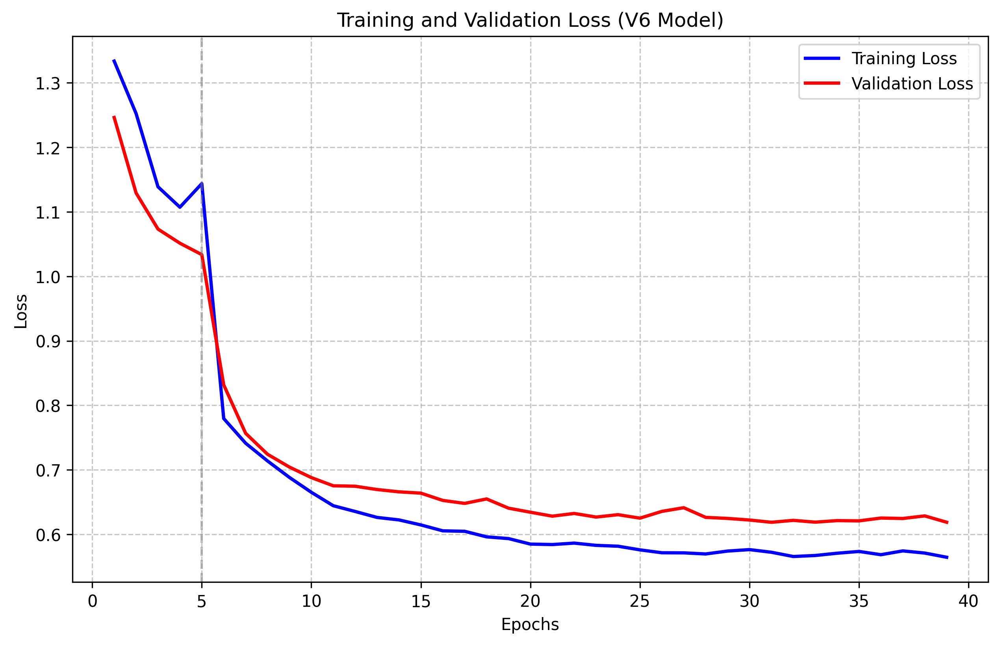
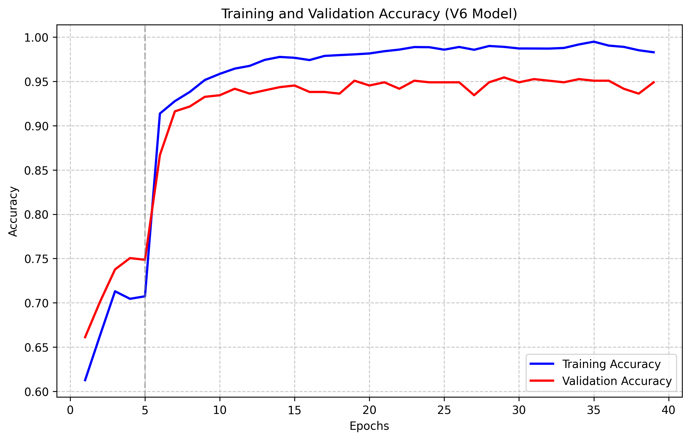
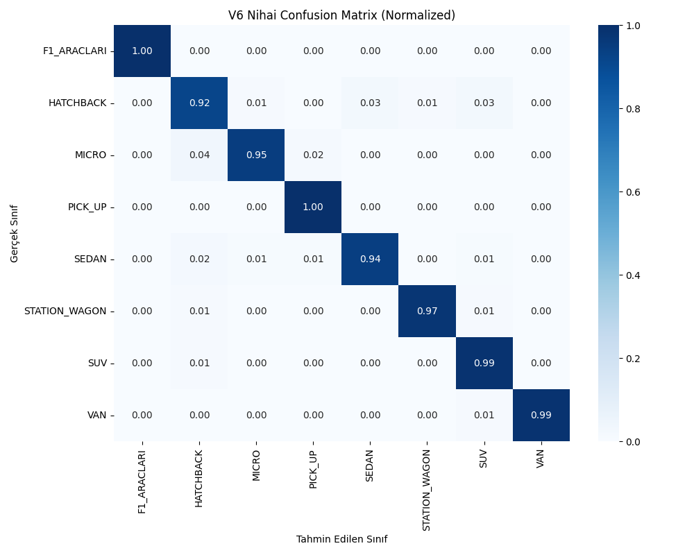

# 🚗 Vehicle Body Type Classifier


An end-to-end deep learning and computer vision project designed to classify **8 different vehicle body types** with high precision. Built upon the **EfficientNet-B4** architecture using a two-phase transfer learning and fine-tuning strategy, the system provides an interactive web interface powered by **Streamlit** for real-time and batch image inference.

---

## 🎯 Model Performance

Evaluated on the balanced validation set, the model achieved the following benchmarks:

- **Macro F1-Score:** `96.83%`
- **Overall Accuracy:** `96.70%`
- **Model Checkpoint Size:** `~68 MB` (Compact and deployment-friendly)
- **Average Inference Latency:** `~25–40 ms / image`

---

## 🏷️ Target Classes

The classifier distinguishes between 8 vehicle categories:

| Script ID | Class Name | Description |
| :---: | :--- | :--- |
| **1** | **SUV** | Sport Utility Vehicle designed for passenger comfort and light off-road utility |
| **2** | **VAN** | Passenger / cargo vans and multi-purpose utility vehicles |
| **3** | **STATION WAGON** | Extended roofline estate / wagon cars with enlarged rear cargo area |
| **4** | **MICRO** | Ultra-compact mini city cars (e.g., Smart Fortwo) |
| **5** | **F1 VEHICLES** | Open-wheel single-seater race cars (Formula 1 / Open-Wheel) |
| **6** | **SEDAN** | Standard 3-box passenger cars (separate engine, cabin, and trunk compartments) |
| **7** | **HATCHBACK** | Compact passenger cars featuring a top-hinged full-width rear liftgate |
| **8** | **PICK UP** | Light-duty commercial vehicles with an enclosed cab and an open cargo bed |

---

## 📊 Dataset

The balanced vehicle image dataset used for training and validation is hosted on Kaggle:

🔗 **Kaggle Dataset:** [Vehicle Body Types Dataset](https://www.kaggle.com/datasets/mmmdpoladl/vehicle-body-types)

> **Key Highlights:**
> - Curated, cleaned, and balanced image collection across 8 vehicle body categories.
> - Advanced data augmentation pipelines applied to prevent overfitting and enhance generalization.
> - `WeightedRandomSampler` incorporated during training to eliminate class imbalance bias.

---

## 🧠 Architecture & Training Methodology

### 1. Backbone & Head
- **Pretrained Backbone:** ImageNet-pretrained `EfficientNet-B4`
- **Input Resolution:** `380 × 380` pixels
- **Custom Classifier Head:** `Dropout(p=0.4)` followed by `Linear(in_features, 8)`

### 2. Two-Phase Training Strategy
1. **Phase 1: Feature Extraction (Epochs 1–5)**
   - EfficientNet feature extraction layers frozen (`requires_grad = False`).
   - Only the custom classification head is trained.
   - Optimizer: `Adam` (`lr = 1e-3`, `weight_decay = 1e-4`)
2. **Phase 2: Full Fine-Tuning (Epochs 6–50)**
   - All layers unfrozen for end-to-end representation adaptation.
   - Optimizer: `AdamW` (`lr = 1e-4`, `weight_decay = 1e-4`)
   - Learning Rate Scheduler: `CosineAnnealingWarmRestarts` (`T_0 = 10`, `eta_min = 1e-6`)
   - Regularization: Early stopping with patience of 10 epochs.
   - Loss Function: `CrossEntropyLoss` with Label Smoothing (`0.1`) and class weights for visually similar classes (`HATCHBACK`, `SUV`, `STATION_WAGON`, `SEDAN` weighted at `2.0`, others at `1.0`).

### 3. Data Augmentation (Albumentations)
- `Resize(400, 400)` & `RandomCrop(380, 380)`
- `HorizontalFlip(p=0.5)`
- `RandomBrightnessContrast(p=0.4)`
- `ShiftScaleRotate(shift=0.08, scale=0.15, rotate=15, p=0.5)`
- `CLAHE` (Contrast Limited Adaptive Histogram Equalization) & `GaussNoise`
- `ColorJitter`, `MotionBlur` / `GaussianBlur`, `Perspective`, and `CoarseDropout`

---

## 📈 Performance Visualizations

### 1. Training & Validation Curves
Loss and accuracy dynamics over training epochs:

| Training & Validation Loss | Training & Validation Accuracy |
| :---: | :---: |
|  |  |

### 2. Normalized Confusion Matrix
8x8 Normalized Confusion Matrix demonstrating balanced inter-class classification:

<p align="center">
  
</p>

---

## 🖥️ Streamlit Web Application

The interactive web dashboard includes four functional modules:

1. **Live Prediction:** Upload single or multiple vehicle images to instantly inspect predicted class, confidence score, inference latency (ms), and a full-class probability distribution bar chart.
2. **Model Specs:** Comprehensive overview of model architecture, trainable parameters, and training metrics.
3. **Batch Inference:** Recursively scans an input folder with arbitrary nested directories, classifies all discovered images, displays paginated visual previews, and exports results to `preds.txt`.
4. **Performance Analysis (Ground Truth Verification):** Uploads prediction files (`preds.txt`) alongside ground truth files (`True.txt`) to dynamically compute overall accuracy, Macro F1-Score, an interactive Confusion Matrix heatmap, and a detailed Classification Report table.

---

## 🚀 Getting Started

### 1. Clone the Repository
```bash
git clone https://github.com/mammadpoladli/car-body-type-classifier.git
cd car-body-type-classifier
```

### 2. Create Virtual Environment & Install Dependencies
```bash
python3 -m venv venv
source venv/bin/activate  # On Windows: venv\Scripts\activate
pip install -r requirements.txt
```

### 3. Download Model Weights
Place the trained checkpoint (`best_model_v6.pth`) into the project root directory.

### 4. Launch the Web Application
```bash
streamlit run app.py
```
The interface will automatically open in your default browser at `http://localhost:8501`.

---

## ☁️ Google Colab Batch Inference

To run batch predictions in a Google Colab notebook:
1. Copy the contents of `PredictionScript.txt` into a notebook cell.
2. Upload `best_model_v6.pth` to the Colab environment.
3. Execute the function:
   ```python
   Predict("/content/testdata")
   ```
4. Predictions will be generated and saved to `/content/preds.txt` in the standard format (`<filename> | Pred: <ID>`).

---

## 📁 Repository Structure

```
car-body-type-classifier/
├── app.py                     # Streamlit interactive web application
├── model.py                   # EfficientNet-B4 model definition
├── dataset.py                 # PyTorch Dataset, Albumentations pipeline & Sampler
├── train.py                   # Two-phase training and validation script
├── classes.json               # 8 vehicle class labels
├── requirements.txt           # Python dependencies
├── PredictionScript.txt       # Google Colab batch inference script
├── README.md                  # Project documentation
├── .gitignore                 # Git ignore rules
├── acc_plot.png               # Training & validation accuracy plot
├── loss_plot.png              # Training & validation loss plot
├── confusion_matrix.png       # 8x8 Normalized Confusion Matrix
└── test_icin_ornek_dosyalar/  # Sample test files
    ├── True.txt
    └── Preds.txt
```
